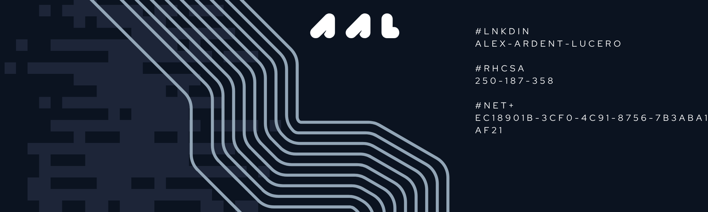

git ⌬ 1970-01-01T00:00:00Z 
↯ aex-a $ fastfetch

SYSTEM INFORMATION 
ROLE - Operations Engineer (GPU / Linux Infra) -> SRE 
CERT - RHCSA (ID: 250-187-358) 
OS - openSUSE Tumbleweed / Fedora / RHEL / Ubuntu 
SYSTEMS - Bare-Metal GPU (ROCm) / PCIe / Redfish BMC / NFS / LDAP 
IAC - OpenTofu / Terraform / GCP 
AUTOMATION - Ansible / Bash / GitHub Actions 
CONTAINERS - Kubernetes (K3s) / Podman / Helm 
OBSERVABILITY - Prometheus / Grafana / Dynatrace 
NETWORKING - RDMA / iproute2 / VPC / OpenWRT / wg 
SECURITY - SELinux / PCI Compliance / Lynis

## 🐧 feat/projects

### [k3s-observatory](https://github.com/aex-a/k3s-observatory) | `Kubernetes` `Prometheus` `Helm` `GCP`
Provisioned an ephemeral single-node K3s cluster on GCP with OpenTofu and deployed `kube-prometheus-stack` via Helm for synthetic Blackbox probing. Includes ADRs covering compute sizing, local-vs-cloud trade-offs, and zero-trust SSH tunneling.

### [ot-trek](https://github.com/aex-a/ot-trek) | `OpenTofu` `GCP` `IaC`
Modular GCP environment managed via OpenTofu, scoped with least-privilege SSH firewall rules and `metadata_startup_scripts` to pull and enable a custom `systemd` monitoring service on boot.

### [tux-utils](https://github.com/aex-a/tux-utils) | `Bash` `Systemd` `Linux`
Linux monitoring and administration utilities written in Bash.
**q-length.sh**: A dual-mode network socket/queue monitor packaged as a native `systemd` service with signal trapping (`SIGINT`/`SIGTERM`) for clean shutdowns.
